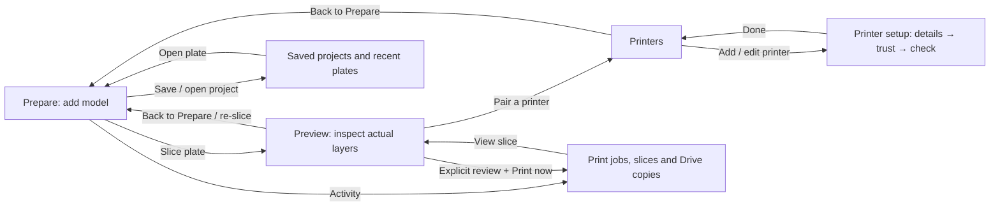
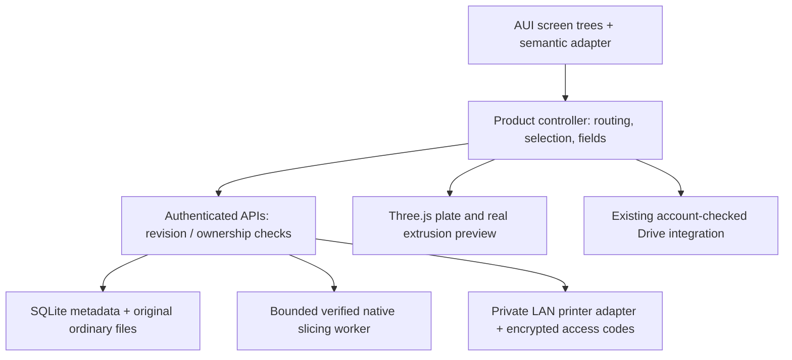
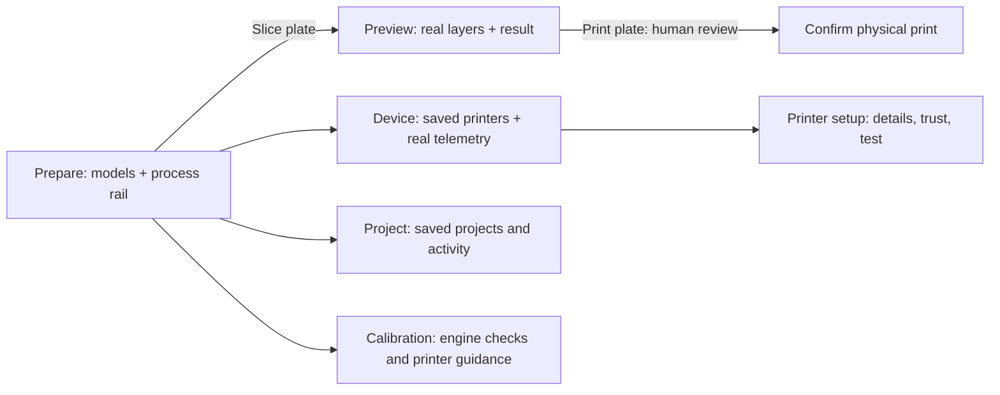

# Flow and state ownership

Routing belongs to the URL hash and preserves the current plate across screens.
The server owns projects/drafts, models, immutable slices, printer records and
dispatch state. No user action must explicitly create a project to import a model.
Draft status is an additive JSON field; absent means an existing saved project.
The browser owns only current controls, unsaved form fields, selection and dialog
state. Access codes never enter local/session storage. Leaving printer setup clears
them. Missing/unknown connection state stays distinct from connected/idle.

Top navigation owns only route changes; project/revision and profile selection stay
in Product. AUI owns UI trees. Scene owns disposable WebGL resources and bounded mesh
cache. Server validates process overrides against a fixed native-key schema; no
scripts, commands or arbitrary slicer keys. Device uses existing pairing/session
authorization and real report fields. Printing requires existing explicit review.
