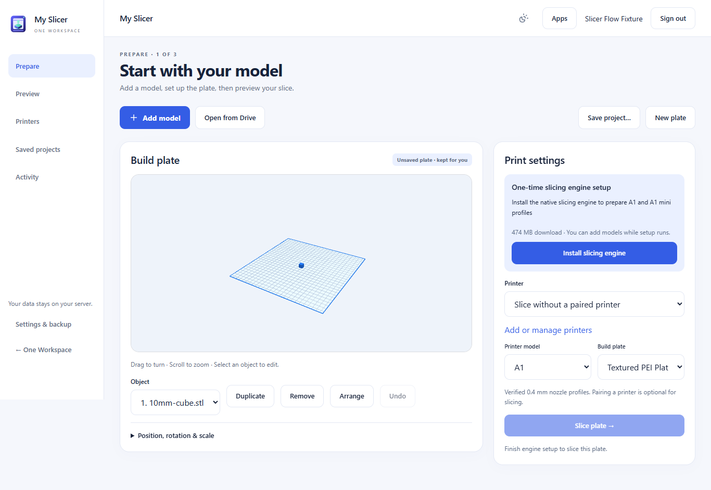

# Prepare a print

1. Open **Prepare** and choose **Add model**, or **Open from Drive** in Workspace.
   Choose an STL or Bambu 3MF. There is no project form to complete first.
   The model appears on the plate before slicing. While it loads, a message shows
   what is happening. If the preview fails, choose **Retry model preview**.
   Imported 3MF layouts are shown as saved; their original print settings are kept.
2. Choose your printer model, material and quality. Add or arrange the objects on
   the plate. Position, scale and advanced settings open only when you need them.
   If prompted, install the slicing engine once; you can add models while it runs.
3. Choose **Slice plate**. On **Preview**, inspect the actual layers, time and
   material estimates. You can download the sliced 3MF here.
4. For direct printing, add a printer from **Printers**. Enter the details from its
   screen, review and trust its certificates, then test the connection. Select that
   printer on Prepare and slice for it. Review the print, check the physical printer
   and loaded filament, then explicitly choose **Print now**.

Adding a printer, trusting it and testing its connection never start a print.
Connection problems stay on the setup screen so you can correct the details.
Leaving setup clears the access code from the form; the saved code stays encrypted.

## Projects are optional

Your work is kept in **Recent plates** after you add a model. Reopening the slicer
restores the latest unnamed plate. **New plate** starts a blank plate and keeps the
previous work available. Existing saved projects are kept too.

Choose **Save project** when you want a name for a reusable plate. Open it later
from **Saved projects**. Importing a native 3MF opens its own plate when necessary
so its layout, modifiers and painting are not mixed with another plate.

**Activity** contains print jobs, previous slices and the status of Drive copies.
Return to Prepare and slice again after changing a model, print settings or target
printer. Printing always needs a current slice and your explicit confirmation.

## The screens

Use **Apps** in the header to switch Workspace apps without a shortcut covering
the slicer controls.

[Prepare on a phone](screenshots/slicer3-prepare-phone.png) ·
[Printer setup on a phone](screenshots/slicer3-printer-phone.png).
